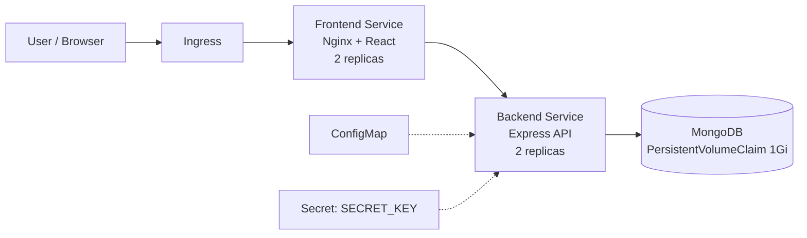

# Full-Stack Housing Dashboard — Docker & Kubernetes

A full-stack MERN application (React, Node.js/Express, MongoDB) with JWT authentication and role-based access, **containerized with Docker** and **deployed on Kubernetes**.

The app lets users sign up, log in and browse a housing dataset through a dashboard with charts and pagination. Admin users can manage all accounts.

## Tech stack

| Layer | Technologies |
| --- | --- |
| Frontend | React 17, Material UI, Recharts, Axios, served by **Nginx** |
| Backend | Node.js 18, Express, Mongoose, JWT, bcrypt, JSON Schema validation |
| Database | MongoDB 7 with a persistent volume |
| Containers | Docker (multi-stage build for the frontend), Docker Compose |
| Orchestration | Kubernetes: Deployments, Services, ConfigMap, Secret, PVC, Ingress |

## Architecture



All resources run in the `fullstack-app` namespace.

## Features

- **Authentication**: register and log in with JWT tokens; passwords hashed with bcrypt.
- **Authorization**: middleware protects routes. Admin-only actions, and users can only edit their own account.
- **Input validation**: every request body is checked against a JSON Schema.
- **Dashboard**: housing data with charts (Recharts), counts and pagination.
- **Seed script**: loads users and housing data from CSV files.

## Docker

### Images

- **Backend**: `node:18-alpine`, installs production dependencies only and runs `server.js` on port 3001.
- **Frontend**: a **multi-stage build**. Stage 1 builds the React app with Node, and stage 2 serves the static build with **Nginx**. The final image is small and contains no build tools. Nginx adds gzip compression, caching for static assets and SPA routing (`try_files ... /index.html`).

### Run everything locally with Docker Compose

```bash
docker-compose up --build
```

| Service | URL |
| --- | --- |
| Frontend | http://localhost:3000 |
| Backend API | http://localhost:3001 |
| MongoDB | localhost:27017 |

Compose waits for MongoDB to pass its **health check** before starting the backend, and all services share a private bridge network.

Seed the database:

```bash
docker exec -it backend node seed.js
```

## Kubernetes

### Manifests (`kubernetes/`)

| File | Purpose |
| --- | --- |
| `namespace.yaml` | Isolates the app in the `fullstack-app` namespace |
| `configmap.yaml` | Non-secret config: `NODE_ENV`, `PORT`, `MONGODB_URL`, `CORS_ORIGIN` |
| `secret.yaml` | `SECRET_KEY` used to sign JWTs |
| `mongodb-deployment.yaml` | MongoDB Deployment, ClusterIP Service and a 1Gi PersistentVolumeClaim |
| `backend-deployment.yaml` | Backend Deployment (2 replicas) and ClusterIP Service |
| `frontend-deployment.yaml` | Frontend Deployment (2 replicas) and LoadBalancer Service |
| `ingress.yaml` | External access through an Ingress controller |

Key choices:

- **2 replicas** for the backend and frontend, for availability.
- **Liveness and readiness probes** on the backend, so Kubernetes restarts unhealthy pods and only sends traffic to ready ones.
- **CPU and memory requests and limits** on every container.
- Configuration comes from a **ConfigMap**, and the JWT key from a **Secret**, so nothing sensitive is hard-coded in the image.
- MongoDB data survives pod restarts thanks to the **PersistentVolumeClaim**.

### Deploy (minikube example)

```bash
# 1. Build the images
./scripts/build-docker.sh

# 2. Load them into minikube
minikube image load fullstack-app-backend:latest
minikube image load fullstack-app-frontend:latest

# 3. Apply all manifests in order
./scripts/deploy-kubernetes.sh

# 4. Check status
kubectl get pods,svc -n fullstack-app

# 5. Open the app
kubectl port-forward -n fullstack-app svc/frontend-service 3000:80
```

Scale or update:

```bash
kubectl scale deployment backend --replicas=3 -n fullstack-app
kubectl rollout restart deployment backend -n fullstack-app
```

More details are in [`kubernetes/README.md`](kubernetes/README.md), [`DOCKER.md`](DOCKER.md) and [`DEPLOYMENT.md`](DEPLOYMENT.md).

## Run without Docker

```bash
# Backend (needs a local MongoDB)
cd backend && npm install && npm run seed && npm start

# Frontend
cd frontend && npm install && npm start
```

## API

| Method | Endpoint | Access |
| --- | --- | --- |
| POST | `/api/auth/register` | Public |
| POST | `/api/auth/token` | Public (login) |
| GET | `/api/homes` | Public |
| POST | `/api/homes` | Authenticated |
| GET | `/api/users` | Admin |
| POST | `/api/users` | Admin |
| GET / PATCH / DELETE | `/api/users/:email` | Admin or account owner |

## What I learned

- Writing Dockerfiles, including a multi-stage build to keep images small.
- Orchestrating a 3-tier app with Docker Compose, health checks and dependencies.
- Deploying to Kubernetes with Deployments, Services, ConfigMaps, Secrets, PVCs, probes and resource limits.
- Securing an Express API with JWT, bcrypt and schema validation.

## Possible improvements

- Push images to a registry and add a CI/CD pipeline (GitHub Actions or Azure DevOps).
- Add a dedicated `/health` endpoint for the probes.
- Use a StatefulSet for MongoDB and restrict `CORS_ORIGIN` in production.
- Add monitoring with Prometheus and Grafana.

## Author

**Krish Bavarva**, Master's student in IT at Epitech Paris
[krishbavarva.com](https://krishbavarva.com) · [GitHub](https://github.com/krishbavarva) · [LinkedIn](https://www.linkedin.com/in/krish-bavarva/)
